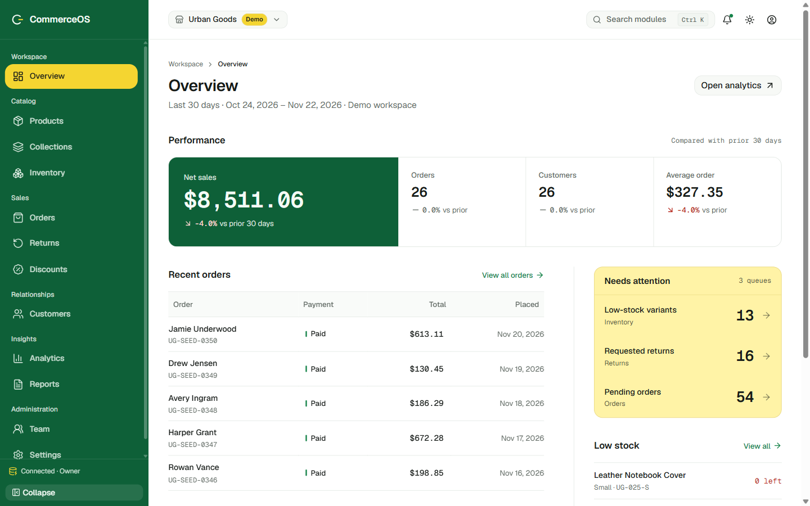
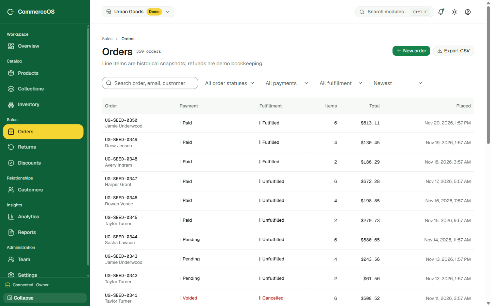
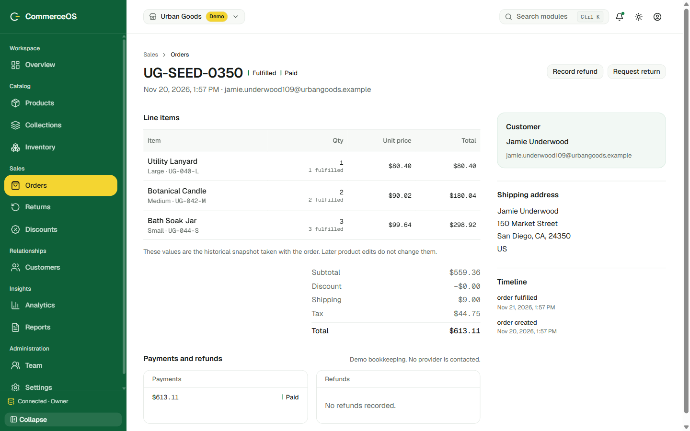
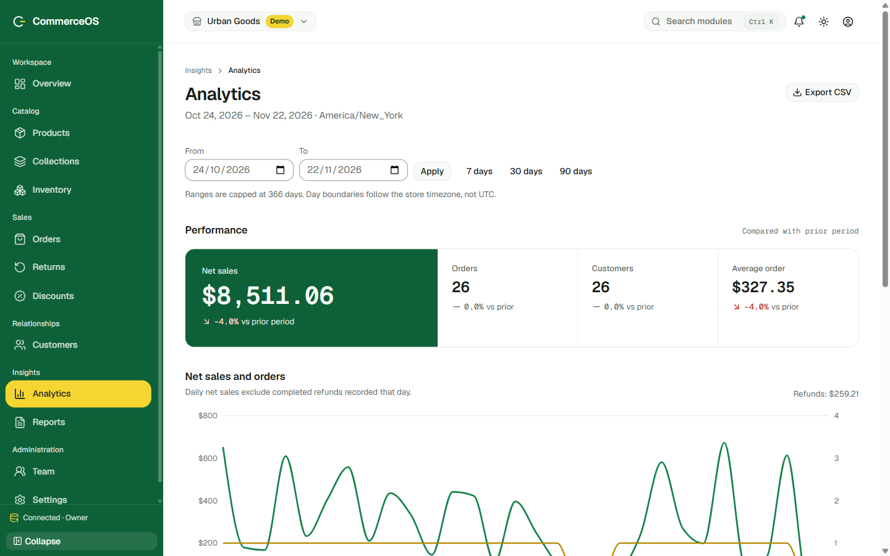

# CommerceOS

CommerceOS is an internal e-commerce operations workspace for the fictional US store **Urban Goods**. It covers catalog, inventory, orders, customers, analytics, discounts, returns, team permissions, and store settings in a single admin product. There is no storefront, checkout, payment provider, or customer messaging, and every record is fictional demo data.

The project is a portfolio-grade demonstration of server-first React, strict TypeScript, tenant-scoped Postgres access, row-level security, transactional commerce workflows, and a restrained operational interface.

> **Staging:** https://commerceos-staging.vercel.app � password-protected, fictional data, no custom domain. Public production/demo is not approved.



## Status

Phase 10 — Deployment and Handoff is complete, followed by a focused production-readiness and security-hardening pass. The hosted Urban Goods workspace contains a deterministic dataset of 50 products, 150 variants, 8 collections, 150 customers, and 350 orders across 12 months, with inventory movements, returns, refunds, discounts, notifications, and low-stock records. A one-click read-only guest demo and a guarded owner reset are available when `DEMO_MODE=true`.

The hardening pass removed direct writes to workflow-owned tables, made all 19 public database functions security-definer with an empty search path, converted the four reporting views to security-invoker, added a nonce-based CSP, and added CI plus catalog-level audit tests.

A separate staging Supabase project and Vercel deployment are live. HTTP Basic protection blocks unauthenticated document requests. The hosted Playwright suite passes 10/10 with credentials, including guest Auth, session reload/sign-out, CSP, accessibility, and responsive checks. Public production/demo approval is still pending. `PROJECT_STATUS.md` records verified state and remaining risks.

## Screenshots

| Orders | Order detail |
| --- | --- |
|  |  |

| Analytics |
| --- |
|  |

Screenshots are captured against the seeded demo workspace.

## Features

- **Overview:** one primary and three supporting period metrics, comparisons, a ledger-style recent-orders table, and a consolidated low-stock/returns/pending-orders attention panel.
- **Products and variants:** search, filters, sorting, pagination, create/edit, archive/restore, duplicate, variants, SKU/barcode, pricing, cost, and URLs for demonstration imagery.
- **Collections:** product counts, create/edit, status, image URL, and atomic product assignment.
- **Orders:** filters, search, CSV export, line-item snapshots, payment/refund records, submitted timeline, cancellation, partial/full fulfillment, and return requests.
- **Customers:** spend, order count, AOV, new/returning classification, addresses, tags, notes, and order history.
- **Inventory:** variant-level on-hand, reserved, and available quantities, thresholds, low-stock filters, immutable movements, and transactional adjustments.
- **Analytics and reports:** net sales, gross sales, refunds, orders, customers, AOV, previous-period comparisons, daily trend chart, product/category performance, documented formulas, and CSV export.
- **Discounts:** percentage or fixed amount, code, minimum subtotal, usage limit, active window, and redemption history.
- **Returns and refunds:** request, approve/reject, partial refund with optional restock, quantity validation, and refund caps.
- **Team:** members, role changes, one-time invitation links, revocation, and activity history.
- **Settings:** store profile, timezone, logo, personal profile, notification preferences, password change, theme, and guarded demo reset.
- **Notifications:** recent operational events with a store-wide read state.

## Stack

| Area | Choice |
| --- | --- |
| Framework | Next.js 16.4.6 App Router, React 19.3.1 |
| Language | TypeScript 5.9, strict mode |
| Styling | Tailwind CSS v4.3.5, generated shadcn/ui primitives, Geist |
| Data | Supabase Postgres and Auth through `@supabase/ssr` 0.12.7 |
| Charts | Recharts 3.11 |
| Validation | Zod 4.6 |
| Utilities | date-fns 4.4, Sonner 2.0, Lucide React 1.76 |
| Testing | Vitest 5.1, React Testing Library 16.3, Playwright 1.65, axe-core |
| Hosting | Vercel staging (public production not deployed) |

Tables are server-rendered and URL-driven; forms use React 19 form actions and `useActionState`. TanStack Table and React Hook Form are not dependencies in this build. Image uploads are not enabled; product and collection image fields accept an HTTPS URL. The shadcn CLI is not installed; its small Tailwind companion stylesheet is vendored in `src/app/shadcn-tailwind.css` so the build has no dev-tool advisory chain.

Versions are pinned in `package.json`. Confirm them before relying on framework APIs.

## Architecture

```text
Browser
  └─ Next.js App Router on Vercel
       ├─ Server Components → features/*/queries.ts → Supabase Postgres (RLS)
       ├─ Server Actions    → Zod → session/role checks → RPC/table writes
       └─ Route handlers    → auth checks → CSV exports
                                      │
                                      └─ Supabase Auth (cookie session) + Postgres
```

- Routing and composition live in `src/app`; module logic lives in `src/features/<module>/`.
- Reads go through server-only `queries.ts`; mutations go through `actions.ts` Server Actions.
- Store scope comes from the session membership, never from a client-supplied `storeId`.
- RLS is the final tenant boundary on all 23 public tables; capability checks are the authoritative action gate.
- Multi-record commerce operations run in Postgres functions so stock, refunds, and state transitions stay atomic.
- Money is stored as integer cents. Timestamps are `timestamptz`; display time uses the store timezone.
- Client Components are leaves for dialogs, charts, menus, and form state.

See [`docs/architecture.md`](docs/architecture.md) for boundaries, request flow, workflows, and tradeoffs.

## Database overview

Fourteen additive migrations create 23 tenant-scoped tables, 39 RLS policies, 19 security-definer functions, and four security-invoker reporting views. The domain groups are:

- **Identity and tenancy:** `profiles`, `stores`, `store_members`, `invitations`.
- **Catalog:** `products`, `product_variants`, `product_images`, `collections`, `collection_products`, `inventory`.
- **Sales:** `customers`, `customer_addresses`, `orders`, `order_items`, `payments`, `refunds`, `discounts`, `discount_usages`, `returns`, `return_items`.
- **Operations:** `inventory_movements`, `notifications`, `activity_logs`.
- **Views:** `inventory_levels`, `inventory_overview`, `inventory_reconciliation`, `order_reconciliation`.

`supabase/seed.sql` calls the deterministic `private.seed_demo_store` function for the `urban-goods` store. Seeding replaces demo records rather than duplicating them.

See [`docs/database-schema.md`](docs/database-schema.md) for relationships, invariants, functions, and RLS.

## Local setup

Requirements: Node.js 22 or newer, npm 10 or newer, and a Supabase project. Docker is only needed for the optional local Supabase CLI stack.

```bash
npm install
cp .env.example .env.local
npm run dev
```

Fill in `.env.local`, then open <http://localhost:3000>. The root redirects to `/dashboard`.

### Environment variables

| Variable | Exposure | Required | Purpose |
| --- | --- | --- | --- |
| `NEXT_PUBLIC_SUPABASE_URL` | Public | Yes | Supabase project URL |
| `NEXT_PUBLIC_SUPABASE_ANON_KEY` | Public | Yes | Supabase anon/publishable key |
| `NEXT_PUBLIC_SITE_URL` | Public | Yes in production | Origin for auth email redirects and invite links |
| `DEMO_MODE` | Server-only | For demo | Enables guest entry and the owner reset tool |
| `STAGING_BASIC_USER` / `STAGING_BASIC_PASSWORD` | Server-only | Staging only | Optional HTTP Basic protection for the protected staging deployment |
| `SUPABASE_SERVICE_ROLE_KEY` | Server-only | No | Reserved placeholder; not used by application code |

Next.js inlines `NEXT_PUBLIC_*` values at build time. Production builds need the production values present. Never expose or commit the service-role key.

### Supabase setup

1. Create a Supabase project and enable email confirmation for staff accounts.
2. Enable anonymous sign-ins if the read-only guest demo is wanted.
3. Set the Auth Site URL to the app origin and allow the callback URLs listed in [`docs/setup-guide.md`](docs/setup-guide.md).
4. Apply migrations in order:

```bash
npx supabase link --project-ref <project-ref>
npx supabase db push
```

If the CLI cannot run locally, apply the SQL files in `supabase/migrations` in filename order through the SQL editor, then run:

```sql
select private.seed_demo_store(id)
from public.stores
where slug = 'urban-goods';
```

5. Register, confirm the email, sign in, and create the store. The first membership is the owner.
6. Set `DEMO_MODE=true` and seed the demo store to expose the guest button.

No Docker is required to use the hosted project. Local Supabase commands such as `supabase start` and `db reset` do require Docker and are not available in every environment.

Full instructions and troubleshooting: [`docs/setup-guide.md`](docs/setup-guide.md).

## Demo environment

- **Try the read-only demo** creates an anonymous Supabase session and joins the demo store as a `viewer`. All capabilities and RLS policies block writes.
- Compact demo labeling and a footer disclosure identify the data as fictional. Metrics are derived from persisted records.
- **Reset** is visible to owners/admins of an `is_demo` store when `DEMO_MODE=true`. It is confirmed twice and regenerates the seeded dataset.
- Anonymous accounts accumulate in Supabase Auth. Reset clears demo memberships, not auth users.
- Team data shows the real owner account rather than fictional staff profiles.
- Images use deterministic `https://picsum.photos` URLs. Supabase Storage is not configured.

## Testing

```bash
npm test                # Vitest unit, component, and PGlite schema/RLS suites
npm run test:integration # Real PostgreSQL concurrency (requires TEST_DATABASE_URL)
npm run test:e2e        # Playwright against a running demo
npm run lint
npm run typecheck
npm run build
```

Latest verified results: **128 Vitest tests across 19 files**, **5 real-PostgreSQL concurrency tests**, and **10 Playwright tests**; lint/typecheck/build pass and `npm audit` reports **0 vulnerabilities**. The hardening and idempotency-lock migrations are applied to the hosted demo.

Playwright needs Chromium installed once:

```bash
npx playwright install chromium
```

The E2E run requires the app, a seeded demo store, `DEMO_MODE=true`, and anonymous sign-ins. Set `PLAYWRIGHT_BASE_URL` to test another origin. E2E creates anonymous guest users. Real-PostgreSQL tests require `TEST_DATABASE_URL` and refuse to reset a database whose name does not end in `_test`. GitHub Actions runs lint, typecheck, Vitest, the real-Postgres suite, audit, and the production build; the optional manual E2E job requires repository secrets and an enabled `E2E_ENABLED` variable.

See [`docs/security.md`](docs/security.md) for audit evidence and residual risks.

## Limitations

- No public production deployment or custom domain; the staging URL is unlisted and deployment protection is not enabled.
- No multi-store switching; the app resolves the first active membership.
- No Supabase Storage uploads. Image fields accept URLs only.
- No real payment provider, checkout, email, SMS, or customer communication.
- No per-user notification read state; notifications are store-wide.
- No saved report definitions; analytics views compute from persisted orders.
- CI is defined but has not run on a remote repository yet.
- Real-PostgreSQL concurrency tests passed locally on PostgreSQL 18.7; they have not run against the hosted Supabase deployment or under sustained load.
- Email confirmation requires working outbound email in the Supabase project.
- Anonymous demo auth users accumulate; reset clears demo memberships, not auth rows.
- Refund and order idempotency keys now use advisory locks plus a unique index; sustained multi-connection load is still unmeasured.

## Documentation

- [`docs/architecture.md`](docs/architecture.md)
- [`docs/database-schema.md`](docs/database-schema.md)
- [`docs/security.md`](docs/security.md)
- [`docs/setup-guide.md`](docs/setup-guide.md)
- [`docs/deployment.md`](docs/deployment.md)
- [`docs/hardening-report.md`](docs/hardening-report.md)
- [`docs/staging-readiness.md`](docs/staging-readiness.md)
- [`docs/operational-readiness.md`](docs/operational-readiness.md)
- [`docs/release-candidate-review.md`](docs/release-candidate-review.md)
- [`docs/public-release-checklist.md`](docs/public-release-checklist.md)
- [`docs/feature-walkthrough.md`](docs/feature-walkthrough.md)
- [`docs/quality-report.md`](docs/quality-report.md)
- [`docs/function-audit.md`](docs/function-audit.md)
- [`docs/policy-audit.md`](docs/policy-audit.md)
- [`docs/portfolio-notes.md`](docs/portfolio-notes.md)
- [`CHANGELOG.md`](CHANGELOG.md)
- [`PROJECT_STATUS.md`](PROJECT_STATUS.md)

## Structure

```text
src/
  app/          routes, layouts, auth callbacks, and page composition
  features/     module queries, actions, schemas, components, and helpers
  components/   shadcn primitives, app-wide components, shell, brand assets
  config/       navigation, routes, and site constants
  lib/          Supabase clients, auth, permissions, validation, formatting
  types/        database types generated from migrations
supabase/       additive migrations, seed, and local config
tests/          unit, component, and PGlite schema/RLS suites
e2e/            Playwright demo, responsive, accessibility, and security specs
docs/           architecture, schema, security, setup, deployment, QA, audits, staging, portfolio notes
```

## Disclaimer

Urban Goods, its products, customers, orders, and all figures are fictional. CommerceOS performs no real payment processing and sends no customer communications. It is not affiliated with Shopify or any other commerce platform.
