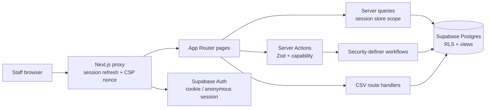
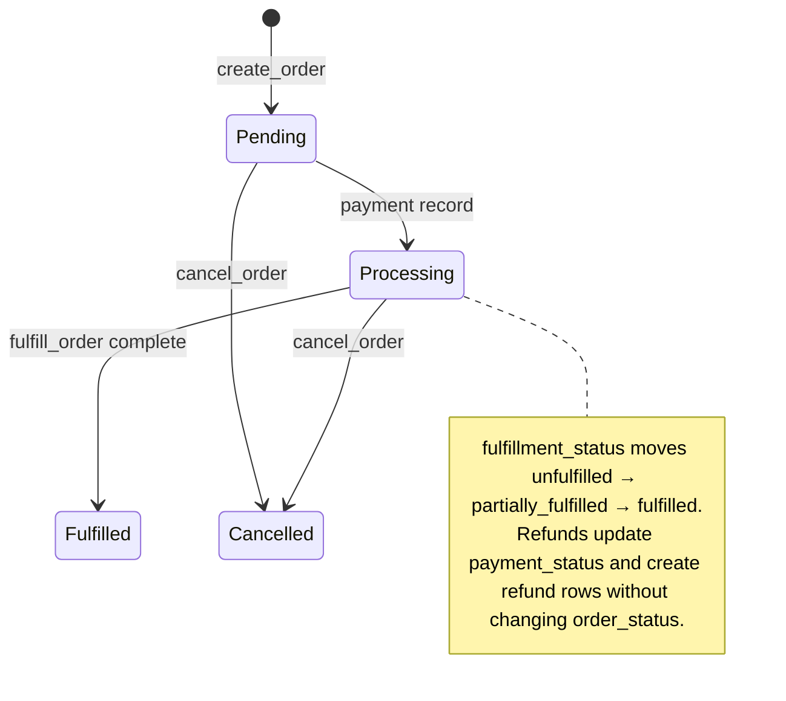

# Architecture

## System shape

```text
Browser
  │  HTML, React Server Component payloads, Server Action requests
  ▼
Next.js 16 App Router (Vercel target)
  ├─ src/proxy.ts                 session refresh + optimistic redirect
  ├─ src/app/(dashboard)          protected shell and route composition
  ├─ features/*/queries.ts        server-only reads, tenant-filtered
  ├─ features/*/actions.ts        Zod, auth, capability, mutation, revalidate
  ├─ src/app/api or route handlers CSV exports with auth checks
  └─ src/lib/*                    Supabase clients, auth context, permissions
  │
  ├─ Supabase Auth                cookie sessions, anonymous demo sessions
  └─ Supabase Postgres            RLS, constraints, workflow functions, views
```

CommerceOS is a single Next.js application with a Supabase backend. There is no separate API service, queue, worker, or payment integration.



## Runtime boundaries

| Layer | Responsibility | Must not |
| --- | --- | --- |
| `src/proxy.ts` | Refresh the Supabase cookie and redirect unauthenticated dashboard requests | Make authorization decisions |
| Dashboard layout | Verify the user and active membership, render the shell | Own fine-grained permissions |
| Server page | Compose data and UI, validate route params | Contain reusable business rules |
| `features/*/queries.ts` | Read and shape server DTOs | Accept raw `searchParams` or client `storeId` |
| `features/*/actions.ts` | Parse, authenticate, authorize, mutate, revalidate | Trust role, store, price, or totals from the client |
| Postgres | Enforce tenancy with RLS and invariants with constraints/functions | Be the only authorization layer |
| Client Component | Dialog, chart, menu, and form interaction | Query Supabase directly |

Server Components are the default. `'use client'` is used only for interactive leaves such as order dialogs, charts, the command search, theme control, and forms that need pending/error state.

## Folder layout

```text
src/
  app/
    (auth)/                  login, register, password flows
    (dashboard)/             protected modules and shell
    auth/callback|confirm/   code and OTP exchange
    invite/[token]/          invitation acceptance
    onboarding/              first store creation
    setup/                   missing-environment screen
    design/                  internal visual reference (noindex)
  features/
    auth/ analytics/ collections/ customers/ discounts/
    inventory/ notifications/ orders/ products/ returns/
    settings/ stores/ team/
      components/            module UI
      queries.ts             server reads
      actions.ts             server mutations
      schemas.ts             Zod contracts
      lib/                   pure helpers
  components/
    ui/                      generated shadcn primitives
    app/                     shared page, table, state, and toolbar pieces
    layout/                  shell, sidebar, topbar, search
    brand/                   wordmark and mark
  config/                    navigation, routes, site constants
  lib/
    supabase/                client, server, config
    auth/                    session and membership resolution
    validation/              schemas and safe redirects
    permissions.ts           role-to-capability map
    format.ts                money/date/number rendering
  types/database.ts          generated database types
```

Routing stays thin. Module behavior, validation, and presentation are colocated in `features/<module>`. Shared cross-module UI lives in `components/app`, not imported feature-to-feature.

## Read path

1. The request reaches a Server Component.
2. `requireMemberContext()` resolves the verified user and first active membership.
3. The page validates route params (including UUID shape) and typed search params.
4. A server-only query selects explicit columns, filters by the session store, and returns a UI-shaped DTO.
5. The Server Component renders the shell and client leaves with serialized primitives.

Queries never accept a raw `searchParams` object or a client-provided store id. RLS is defense in depth; every query also includes the store predicate.

Pagination is bounded, sorting is allowlisted, and filtered-empty/empty/error states are separate UI states.

## Mutation path

```text
unknown input
  → Zod parse
  → getAuthContext / requireMemberContext
  → requireCapability
  → RLS-scoped mutation or transactional RPC
  → revalidatePath
  → typed ActionResult
  → Sonner success or form error
```

Server Actions are public endpoints. Expected validation and permission failures return typed results rather than throwing. Store scope and actor identity are derived from the session. Retry-sensitive refunds and order creation use idempotency keys.

## Commerce workflows

Multi-record operations run in Postgres functions so a browser retry or partial failure cannot leave split state. All 19 public functions are security-definer with an empty search path and explicit role checks. Direct writes are revoked on the nine workflow-owned tables, so the RPC path is the only authenticated DML path.



| Workflow | Function | Invariants |
| --- | --- | --- |
| Create order | `create_order` | Validates product/variant ownership, active status, price, discount, stock; snapshots items; reserves stock; writes order, payment, activity |
| Fulfill order | `fulfill_order` | Only reserved units, partial or full, updates item and header state, writes movements and timeline |
| Cancel order | `cancel_order` | Legal transitions only; restores reserved/on-hand stock once |
| Refund | `record_refund` / `record_refund_once` | Capped at captured amount, idempotent by key, updates payment state |
| Return request | `create_return` | Quantities cannot exceed ordered or already-returned units |
| Return decision | `decide_return` | Approve/reject state machine |
| Return refund | `refund_return` | Optional restock; reuses refund caps and movements |
| Inventory adjustment | `adjust_inventory` | Immutable movement, positive/negative guard, on-hand/reserved consistency |
| Discount redemption | `redeem_discount` | Active window, minimum, usage limit, code ownership |
| Product creation | `create_product` / `add_product_variant` | Product, variants, and initial inventory stay consistent |
| Demo reset | `reset_demo_store` | Owner/admin + `is_demo` + server demo mode |

Order items store snapshots of product title, variant title, SKU, unit price, discount, and totals. Later catalog edits do not rewrite history.

## Data model principles

- UUID primary keys; `store_id` on owned records.
- Integer cents for all money; no floating-point arithmetic.
- `timestamptz` in UTC; analytics day boundaries use the store timezone.
- Explicit enums/checks for order, payment, fulfillment, return, and role states.
- Store-scoped uniqueness for SKUs and discount codes.
- Historical rows are preserved; destructive cascades are avoided for order/payment/refund history.
- `on_hand`, `reserved`, and derived available quantities are reconciled by views and tests.

## Analytics

Analytics are computed from persisted orders, refunds, and order-item snapshots:

- Gross sales = sum of item subtotal snapshots for non-cancelled orders in range.
- Discounts = sum of order discount fields.
- Refunds = completed refunds created in range.
- Net sales = gross sales − discounts − refunds.
- Orders = non-cancelled orders placed in range.
- Customers = distinct customers on those orders.
- AOV = net sales ÷ orders.
- Product/category performance uses order-item snapshots, not current catalog values.

Day grouping uses the store timezone, not UTC or browser time. Formulas are documented in the analytics feature and covered by unit tests.

## Demo architecture

- `DEMO_MODE` is a server-only environment flag. It enables the guest button and reset action.
- Guest entry creates a real anonymous Supabase session, then calls `join_demo_store` to create a `viewer` membership on the demo store.
- `viewer` has read capabilities only. RLS policies deny writes; server actions also reject missing capabilities.
- Reset is a security-definer function with explicit `is_demo`, owner/admin, and demo-mode checks. It replaces demo records atomically and never touches non-demo stores.
- The seed is deterministic and idempotent. Data lives in the database, not in components.

## Security hardening and delivery

- `src/proxy.ts` generates a per-request CSP nonce, sets the policy on the response, and forwards the nonce to the root layout. All document routes are dynamic so Next.js can inject the nonce.
- Instruction-sensitive writes (`orders`, `order_items`, `payments`, `refunds`, `returns`, `return_items`, `inventory`, `inventory_movements`, `discount_usages`) have no authenticated DML grants or write policies. Security-definer workflows are the only path.
- Reporting views use `security_invoker = true`.
- Same-key order and refund submissions take a transaction-scoped advisory lock before the unique-index check, so concurrent retries return the existing row.
- GitHub Actions (`/.github/workflows/ci.yml`) runs install, lint, typecheck, Vitest, audit, the production build, and a PostgreSQL service concurrency job on pushes/PRs. An optional manual E2E job runs only when `E2E_ENABLED` is set and repository secrets are provided.
- `npm audit` is clean after removing the unused shadcn CLI and vendoring its Tailwind companion stylesheet.

## Error handling

- Query failures throw a server-side typed error; users see a safe page-level message.
- `src/app/(dashboard)/error.tsx` provides retry for recoverable render failures.
- `src/app/not-found.tsx` handles unknown routes; entity pages call `notFound()` for missing or invalid ids.
- Server Action failures return safe messages and field errors. Raw Postgres errors are not surfaced.
- Every list has loading, empty, error, and filtered-empty states. Mutations expose pending, success, and failure.

## Deliberate deviations

- **No TanStack Table:** lists are server-rendered with URL-driven sort/filter/page state, which keeps tenant filtering on the server and avoids a client data cache. Complex client sorting was not needed.
- **No React Hook Form:** forms use native form submission, Server Actions, and `useActionState`, keeping validation authoritative on the server.
- **No Supabase Storage:** the demo uses deterministic external image URLs. Upload validation and bucket policies are deferred rather than shipped half-configured.
- **No service-role client:** app code uses the anon key plus user sessions and RLS. A privileged admin path would add risk without a current need.
- **Vendored shadcn Tailwind CSS:** the CLI is not a dependency; its 16 KB companion stylesheet is committed so the generated components keep their variants without the CLI's advisory chain.
- **PGlite test harness:** Docker is unavailable in the development environment, so migrations and RLS are applied to an in-process WASM Postgres for tests, in addition to being applied to the hosted project.

## Performance posture

The app is server-first: no client-side data fetching library, no global client store, and minimal serialized client props. Charts and interactive dialogs are the main client bundles. Warm local-development timings are recorded in `PROJECT_STATUS.md`; they are not Lighthouse or field Core Web Vitals and should be re-measured after deployment.

## Related documents

- [Database schema](database-schema.md)
- [Security model](security.md)
- [Setup guide](setup-guide.md)
- [Deployment](deployment.md)
