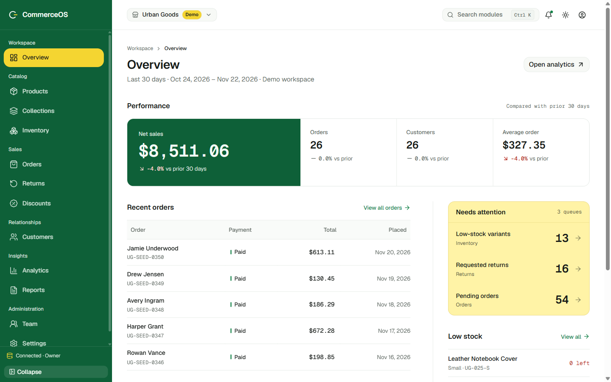
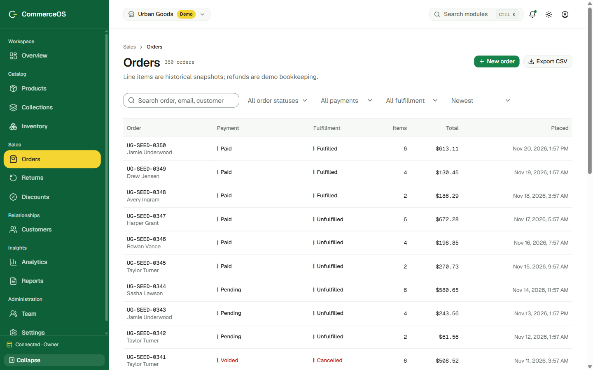
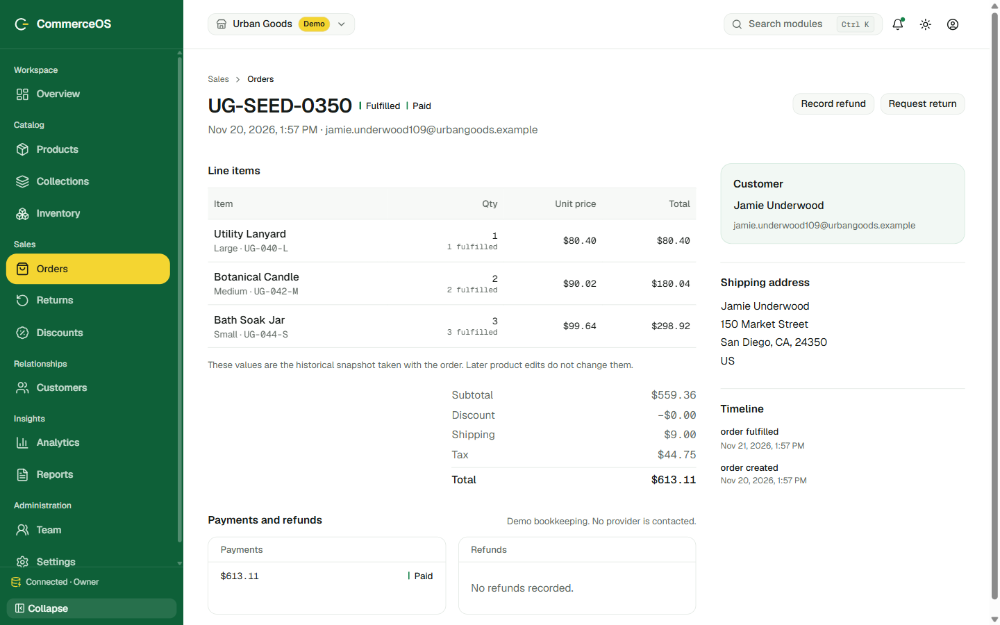
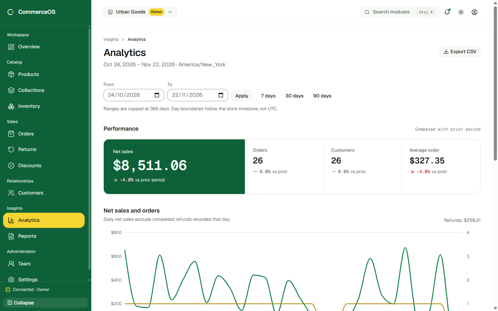

# Feature walkthrough

A five-minute guided review for recruiters, hiring managers, and technical reviewers. Use the protected staging URL with credentials supplied out-of-band, or a local seeded workspace.

## 1. Overview

Start at `/dashboard`. Point out:

- Compact demo labeling, a footer disclosure, and reconciled seeded metrics.
- Last-30-day net sales, orders, customers, AOV, and previous-period deltas.
- Ledger-style recent orders and one consolidated attention queue for low stock, returns, and pending orders.

The metrics come from persisted orders, refunds, and order-item snapshots, not hardcoded values.

## 2. Read-only demo boundary

The guest receives a real anonymous Supabase session and a `viewer` membership. Every write is denied by both capability checks and Postgres RLS. Point out the absent fulfillment/refund/cancel controls. Direct REST updates and inserts on the nine workflow tables return 403/42501.

## 3. Orders and history

Use filters, search, sorting, and pagination. Open an order and note:

- Historical line-item snapshots (title, variant, SKU, price).
- Payment/refund bookkeeping labeled as demo data.
- Totals that reconcile with the item snapshots.

## 4. Analytics

Explain:

- Net sales = gross sales - discounts - completed refunds.
- Day boundaries use the store timezone.
- Product/category performance comes from order-item snapshots.
- CSV export requires an authenticated member and is store-scoped.

## 5. Security and engineering

- `src/proxy.ts`: session refresh, nonce CSP, optional staging Basic Auth.
- Server Actions: Zod ? authentication ? capability check ? RPC/table mutation ? revalidation.
- Postgres: 23 tenant-scoped tables, RLS, 19 definer workflows, four security-invoker views.
- Direct writes to workflow tables are revoked; same-key order/refund retries use advisory locks.
- Tests: 128 Vitest, 5 real-PostgreSQL concurrency, 10 hosted Playwright.

## 6. Honest limitations

Mention the viewer-only public demo, no staff email flow, no Storage uploads, no multi-store switching, no custom domain, and no Supabase backups. The staging URL is protected and the public demo is not yet approved.

## Architecture links

- [Architecture](architecture.md)
- [Database schema](database-schema.md)
- [Security](security.md)
- [Operational readiness](operational-readiness.md)
- [Release checklist](public-release-checklist.md)
